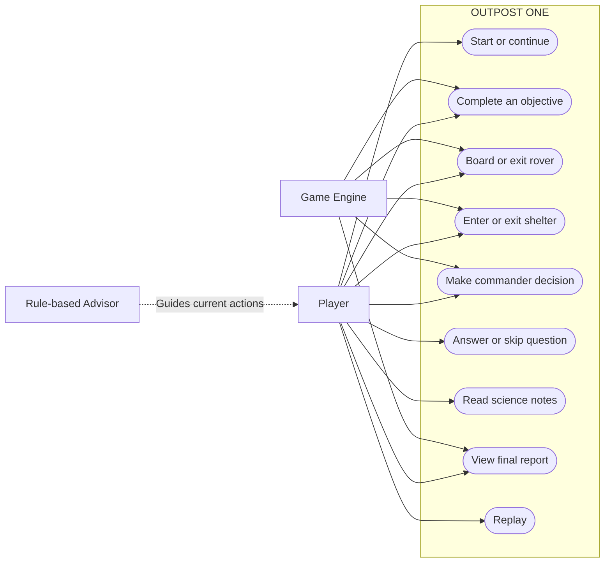

# Use cases

## Actors

- **Player:** chooses actions and reads feedback.
- **Rule-based Advisor:** derives advice from current state. An internal collaborator, not an independent user or AI service.
- **Game Engine:** applies rules and returns the next state. Also an internal collaborator.

Mermaid has no native UML use-case diagram. This flowchart uses rounded nodes to show use cases.

## Start or continue mission

- **Preconditions:** Menu open. Continue also needs a readable version-2 save whose state is `playing`.
- **Main flow:** Choose difficulty → Start Mission → `createGame()` → play screen → simulation and autosave begin.
- **Alternatives:** Continue Mission restores saved state and normalizes learning/report data. Missing, invalid JSON, wrong-version or finished saves do not produce a Continue option. Starting fresh replaces progress on the next successful autosave.
- **Postconditions:** A playing game is held in React state. UI speed and sound are not restored from the save.

## Complete an objective

- **Preconditions:** Playing, correct objective active, close enough to its location, no work already in progress. The UI blocks world interaction during commander decisions.
- **Main flow:** Approach → E/Space or interaction button → work starts → remain in range → ticks finish work → effects, XP and next objective.
- **Alternatives:** Out-of-range or wrong-order actions show a notice. Leaving range cancels work. Survey requires the rover; relay work requires being outside it. Objectives 6 and 7 use shelter/storm conditions instead of a work timer.
- **Postconditions:** A completed objective is recorded once; after the relay, status becomes `won`.

## Board or exit rover

- **Preconditions:** Playing, no timed work, no commander dialog. Boarding needs commissioned habitat, proximity to the parked rover and energy at least 8.
- **Main flow:** Interact with rover → toggle riding state → drive. Interact again → park at the player's current position → resume walking.
- **Alternatives:** Low power prevents boarding; energy below 4 during a tick forces exit. Entering shelter also exits and parks the rover. At the final relay, interaction priority exposes exit before repair.
- **Postconditions:** `rover` and `roverPosition` reflect the result. No separate rover battery exists.

## Enter or exit shelter

- **Preconditions:** Playing, in shelter radius, no work or commander dialog.
- **Main flow:** Interact → toggle `sheltered`; entry logs time and storm phase. Entering during objective 6 completes it.
- **Alternatives:** Entry can happen before warning, during the storm or after it. An early visit before objective 6 does not pre-complete that objective. If the storm already passed, late entry can still lead to objective 7 completion on a later tick.
- **Postconditions:** Entry disables movement, exits the rover and reduces relevant drains. Exit restores outdoor movement and exposure. Shelter exit takes interaction priority.

## Make a commander decision

- **Preconditions:** A pending dust, leak or battery event while playing.
- **Main flow:** Read problem and options → choose → `chooseEvent()` applies difficulty-specific, clamped changes → log and measured deltas update → dialog closes → failure check.
- **Alternatives:** Invalid choice or missing event does nothing. An unaffordable choice is not disabled by the engine; reaching zero can lose the mission. Time and drain continue during the dialog unless the game is paused.
- **Postconditions:** Pending event cleared. World controls resume if still playing.

## Answer a knowledge check

- **Preconditions:** A completed objective with a question: oxygen, solar, ice or survive. Its question has not been answered or skipped.
- **Main flow:** Open the completion learning card → select an option → immediate correct/incorrect feedback and explanation.
- **Alternatives:** Skip records a skipped response. Invalid inputs and repeat responses are ignored. Completed lessons can be reviewed using the lesson selector, including on the outcome screen.
- **Postconditions:** Learning counts are normalized. No resource, XP, objective or survival effect; questions do not pause play.

## View science notes

- **Preconditions:** Menu open.
- **Main flow:** Mission Briefing → Science notes & NASA sources → expand one of ten topics → read explanation, relevance and simplification → optionally open NASA link.
- **Alternatives:** Close the briefing to return to the menu. An unverified normal source displays a verification message instead of a link; the archived DONKI block has its own explicit warning and link.
- **Postconditions:** No game-state change. Source clicks are not counted.

## View final report

- **Preconditions:** Status is `won` or `lost`.
- **Main flow:** Outcome automatically opens → review mission, engineering and educational sections, learning cards and log.
- **Alternatives:** Older saves may show partial history and unavailable decision measurements. Source exploration always says not tracked.
- **Postconditions:** Results are visible; simulation is stopped and the autosave is removed. Answering a remaining quiz here updates the current report but does not save a completed campaign.

## Replay

- **Preconditions:** Outcome screen, or pause screen for Restart mission.
- **Main flow:** Replay mission → fresh `createGame()` at the same difficulty.
- **Alternatives:** Main menu returns to difficulty selection. Pause → Restart also creates fresh state at the same difficulty.
- **Postconditions:** Objectives, resources, learning and report history restart. Replay does not explicitly reset the UI speed or sound settings.
