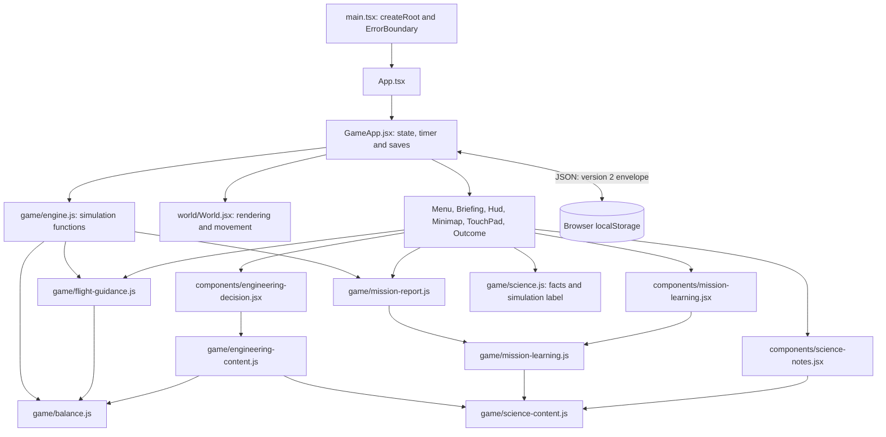
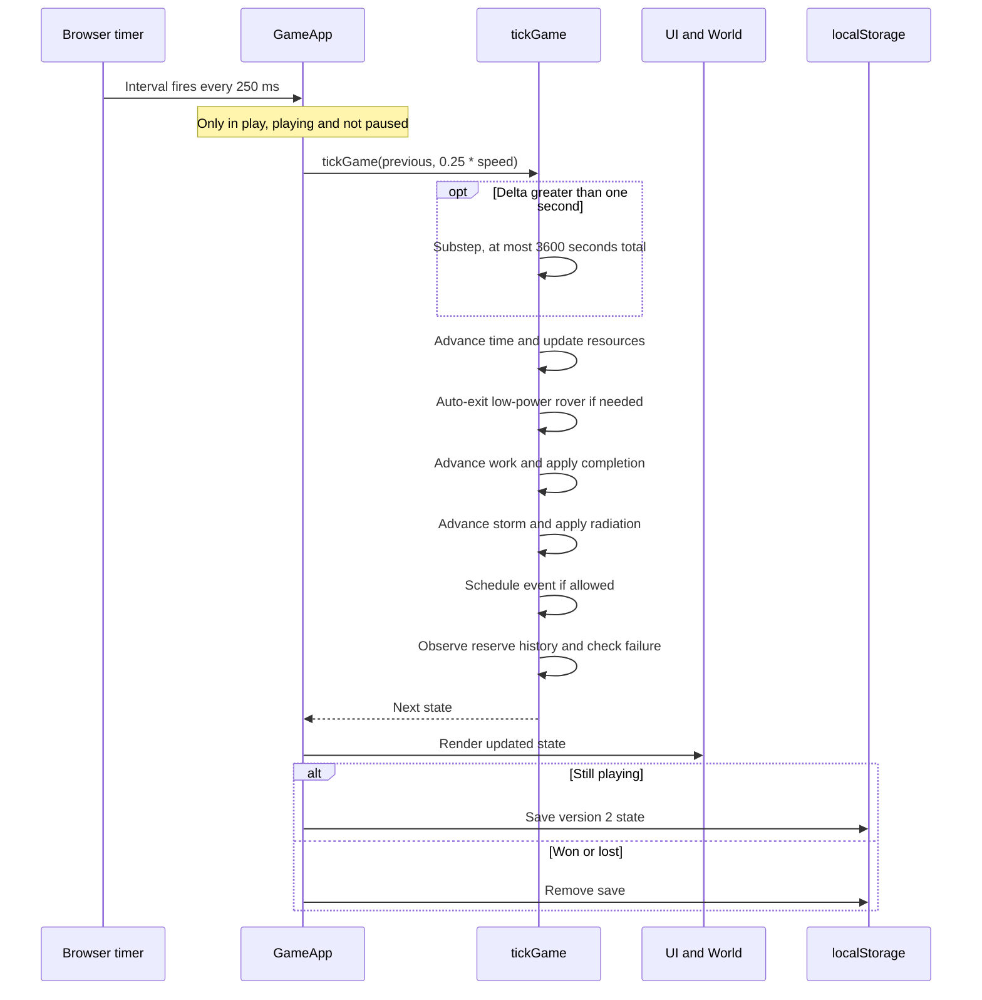
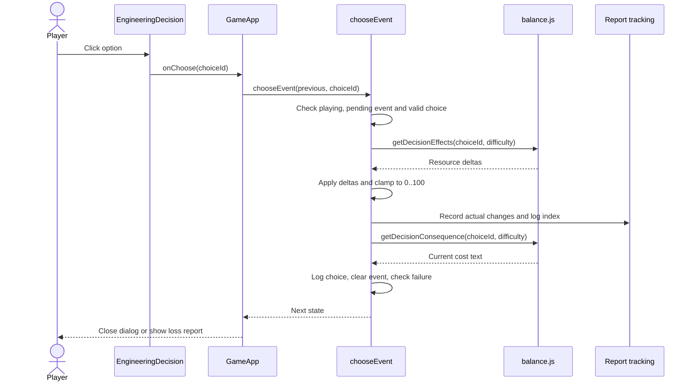
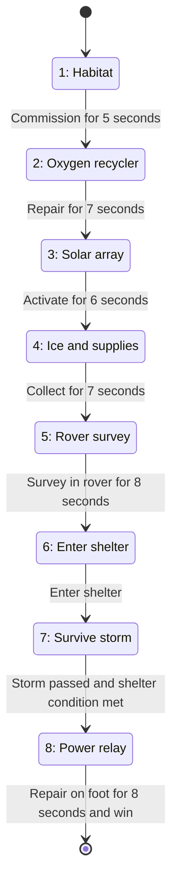
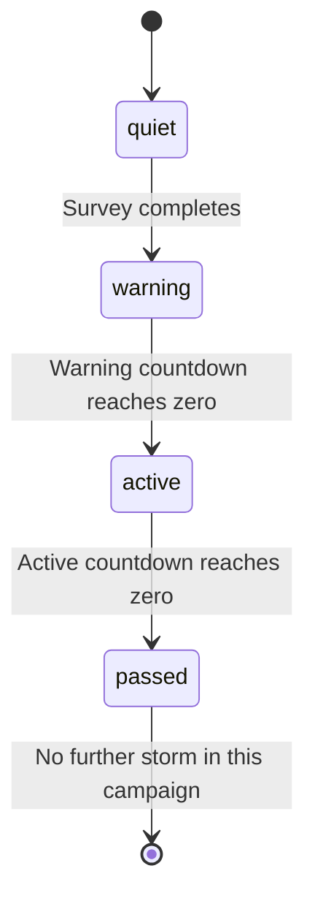
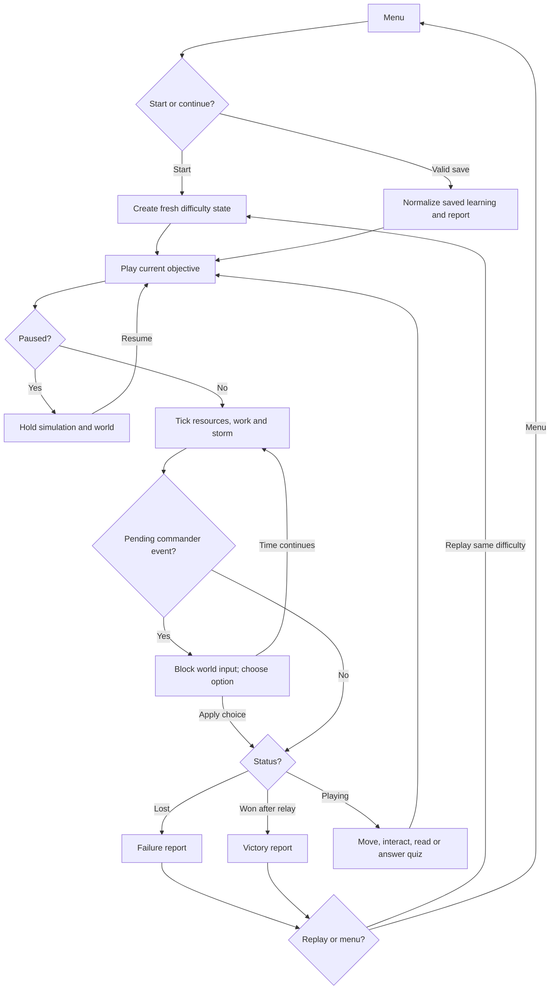

# UML and flow diagrams

These describe functions and React components, not invented JavaScript classes. `GameApp.jsx` owns several components and the save functions in the same file.

## A. Component/module diagram

## B. One game tick

The timer is independent of the WebGL frame loop. A commander dialog holds movement, not this timer. At 4x speed the UI still supplies exactly a one-second delta.

## C. Commander decision

Invalid calls return the existing state without completing the flow.

## D. Eight-objective state diagram

Failure from any playing stage is shown in the full-mission diagram below. For late arrival, enter shelter to complete objective 6; if the storm has passed, a later tick completes objective 7 while sheltered. Continuous shelter occupancy is not required.

## E. Storm state diagram

Warning is 65/45/30 seconds for Easy/Normal/Hard. Active is 35 seconds. `passed` turns solar generation off. Mission end freezes further ticks; replay creates `quiet` again.

## F. Full-mission activity

