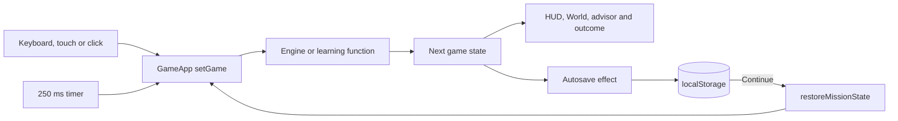

# Architecture

## Stack actually used

- **React / React DOM:** components, state, effects and browser rendering.
- **JavaScript JSX:** most game UI and simulation modules. TypeScript wraps the app and Vite setup.
- **Three.js:** 3D geometry, lighting, materials and scene math.
- **React Three Fiber:** connects React to Three.js; `useFrame` drives visual movement.
- **Drei:** helpers including keyboard controls and stars.
- **Vite:** development server, module loading and production bundling.
- **CSS and Tailwind tooling:** styling; game-specific CSS keeps the current interface.
- **Lucide React:** interface icons.
- **Web Audio API:** optional generated ambience.
- **Node assert/test and crypto:** simulation assertions, source-checker tests and benchmark digests.

The package manifest includes other template dependencies. Being installed does not mean a library is part of the game loop. The game's current play path does not need the separate API artifact.

## Important files

Under `artifacts/lunar-survival/`:

```text
src/
  main.tsx                      Mounts React and the error boundary
  App.tsx                       Renders GameApp
  GameApp.jsx                   Menu, HUD, outcome, input, timer, localStorage
  game.css                      Main game interface styles
  index.css                     Global styles
  world/World.jsx               3D outpost, terrain, astronaut, rover, camera
  game/
    engine.js                   State, objectives, movement, interactions, ticks
    balance.js                  Difficulty rules and decision costs
    flight-guidance.js          Rule-based advice and resource/storm explanations
    science.js                  Simulation disclaimer, facts, unused provider seam
    science-content.js          Ten topics, NASA sources, archived flare
    engineering-content.js      Event problems, trade-offs and source metadata
    mission-learning.js         Eight lessons, four questions, learning defaults
    mission-report.js           Report calculations, reserve history and ratings
    engine.test.mjs             Campaign, learning, reporting and rule assertions
    balance.test.mjs            Difficulty effects and compatibility assertions
    balance-benchmark.mjs       Seeded strategy campaigns and baseline comparison
  components/
    engineering-decision.jsx    Commander decision dialog
    science-notes.jsx           Expandable topics and source links
    mission-learning.jsx        Current science, completion cards, optional questions
    mission-learning.css        Compact learning styles
    mission-report.css          Outcome/report layout and scrolling
    error-boundary.tsx          React error fallback
vite.config.ts                  Required env, host/port, build output
package.json                    Game commands and dependencies
scripts/
  check-source-links.mjs        Network availability checker for source registry
  check-source-links.test.mjs   Mocked tests for that checker
  README.md                    Checker usage
```

Other template files exist, such as hooks, generic UI components and a not-found page. This is a map of the important game files, not a claim that every template component is used.

## Data flow



`game` is authoritative. The 3D scene has local positions for smooth rendering and sends movement updates back. UI states such as menu mode, pause, speed, sound and navigation targets live outside the saved game.

## Simulation versus rendering

While playing and not paused, the UI calls `tickGame(game, 0.25 * speed)` every 250 ms. Speed cycles through 1x, 2x and 4x.

The 3D frame loop handles walking/driving independently: nominal speeds are 4.6 and 9 world units per frame-second, with frame delta capped at 0.05 seconds. Movement callbacks are batched after about 0.12 accumulated frame-seconds. Low frame rates can therefore slow travel relative to the separate simulation clock. Speed controls do not multiply the movement speed.

During commander dialogs, the world enters `hold`, and UI movement/interaction callbacks reject world actions. The simulation timer continues unless paused. These restrictions are UI-level; pure engine functions do not all reject `state.event` themselves.

## localStorage and compatibility

Key: `outpost-one-save`. Saved JSON:

```json
{
  "version": 2,
  "state": { "status": "playing" }
}
```

The example shows the envelope only; `state` actually contains the full game state. Its internal `version: 1` is separate from the storage envelope's version 2.

- The save effect runs when game state changes in play mode, including movement and quiz changes.
- `loadSave()` accepts only envelope version 2 with a playing state.
- `restoreMissionState()` adds safe learning/report defaults for older **version-2** saves. This is not a general migration of every old schema.
- Learning responses are validated and counts recomputed. Missing report history is marked incomplete; historical measurements are not fabricated.
- Invalid JSON/read errors return no save. Write errors clear the UI's saved-state reference but do not interrupt the running mission.
- Winning or losing removes the active save. There is no saved results archive or cloud sync.
- Starting or replaying creates fresh state. Ordinary menu return during play keeps the in-progress save.
- These functions are not a complete validator for arbitrary corrupted game state. Unknown storage versions are not migrated.

## Build and deployment

From the repository root:

```bash
NODE_ENV=production PORT=25174 BASE_PATH=/ pnpm --filter @workspace/lunar-survival run build
```

Vite outputs `artifacts/lunar-survival/dist/public`. Deploy **the contents** of that directory with `index.html` at the static site's root. No API process is needed by the current game.

For a local production preview:

```bash
PORT=25174 BASE_PATH=/ pnpm --filter @workspace/lunar-survival run serve
```

Use an available port; do not start another server on an occupied workflow port. `serve` is Vite preview, not a requirement for static hosting.

`PORT` and `BASE_PATH` are checked when the config loads. The server binds `0.0.0.0`; development uses strict port selection and allows proxied hosts. A subdirectory deployment needs the matching trailing-slash base path at build time. The current game has no route-based page navigation requiring a documented rewrite rule.

This guide describes build configuration, not the current health or settings of any published deployment. It does not verify a production URL.
